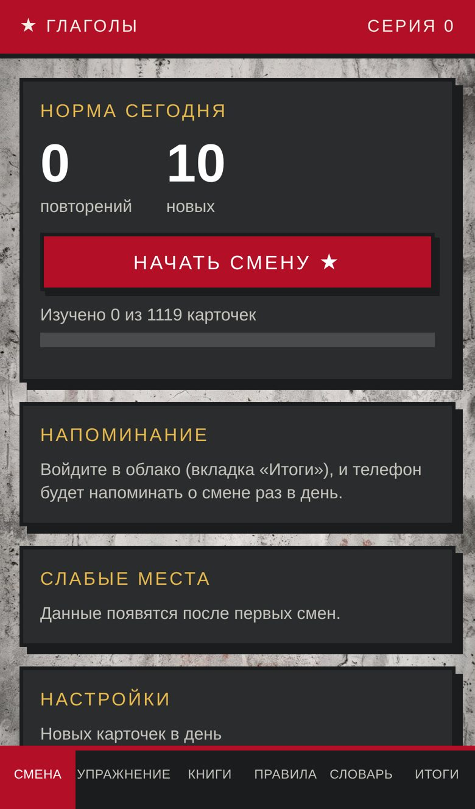
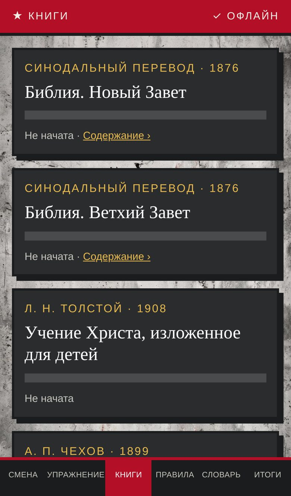
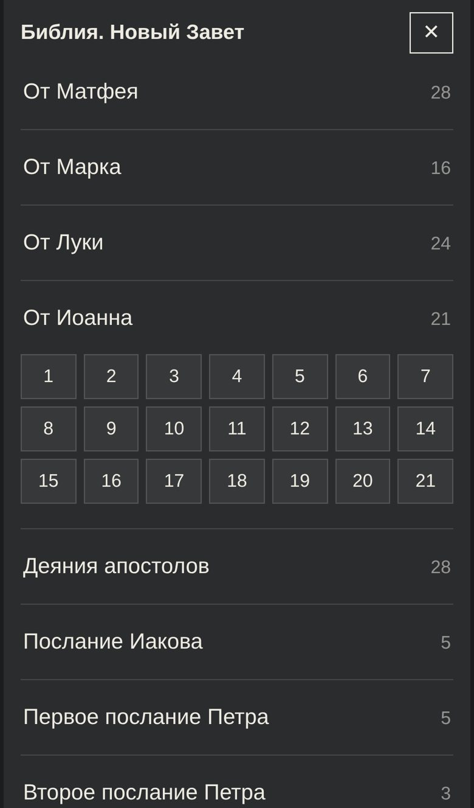
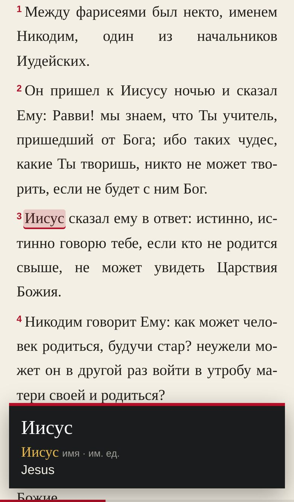
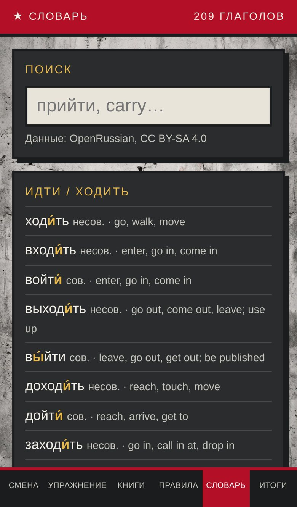

<h1 align="center">Глаголы</h1>
<h3 align="center">Russian verbs, finally conquered. And now, the Bible in your pocket.</h3>

<a href="https://joshp523.github.io/russian/"><b>▶ Open the app</b></a>

<table><tr>
<td align="center"> <b>Daily shift</b></td>
<td align="center"> <b>The library</b></td>
<td align="center"> <b>Any book, any chapter</b></td>
<td align="center"> <b>Tap any word</b></td>
<td align="center"> <b>Verb dictionary</b></td>
</tr></table>

## ✦ New: the Russian Bible
**All 66 books of the Synodal Translation.** The classic 1876 text, faithful and public domain, laid out as a calm, beautiful book.

**Tap any word.** Its meaning, its grammar and its stress appear instantly, and your phone says it aloud. Tap again to hear the whole sentence.

**Even the old words.** *Дщерь, вопиять, сей, дабы, Израилев.* A hand-made glossary covers the archaic Synodal vocabulary and over a hundred biblical names.

**Jump anywhere.** Open the contents, pick a book, tap a chapter. Verse numbers sit quietly in the margin.

**Completely offline.** Text, dictionary and voice all live on your phone. Read on a plane, in a monastery, in a tunnel.

## ✦ The verb trainer
**Verbs of motion, tamed.** Daily shifts of spaced-repetition cards with real sentences from Tolstoy, Dostoevsky, Chekhov and more.

**Weak spots, found.** The app learns where you stumble and brings those verbs back.

**A full verb dictionary.** Every form, every stress, every aspect pair.

## ✦ The library
The Bible, plus Tolstoy, Chekhov and *The Brothers Karamazov.* All with tap-to-translate, your place saved automatically, and nothing to distract you.

---

### On your phone
Open the link in Safari (iPhone/iPad) or Chrome (Android), then choose **Share → Add to Home Screen**. It gets its own icon and opens full-screen, just like an app from the store.

### More apps by Josh Riley
[The Riley Rag](https://joshp523.github.io/RileyRag/) · [QuipRash](https://joshp523.github.io/Quip-game-app/) · [Word Games](https://joshp523.github.io/Word-Games/) · [Riley Rangers](https://joshp523.github.io/Rangers-app/) · [Habits: Josh](https://joshp523.github.io/daily-discipline/) · [Habits: Meishe](https://joshp523.github.io/Habit-tracker-app-Meishe/) · [Habits: Grandma](https://joshp523.github.io/wendys-app/) · [Writing](https://joshp523.github.io/writing-app/)

Built by Josh Riley. Setup notes for whoever maintains it are in [SETUP.md](SETUP.md).
