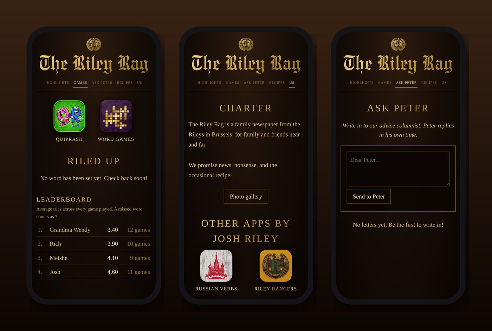
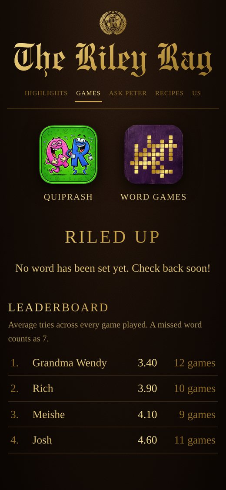
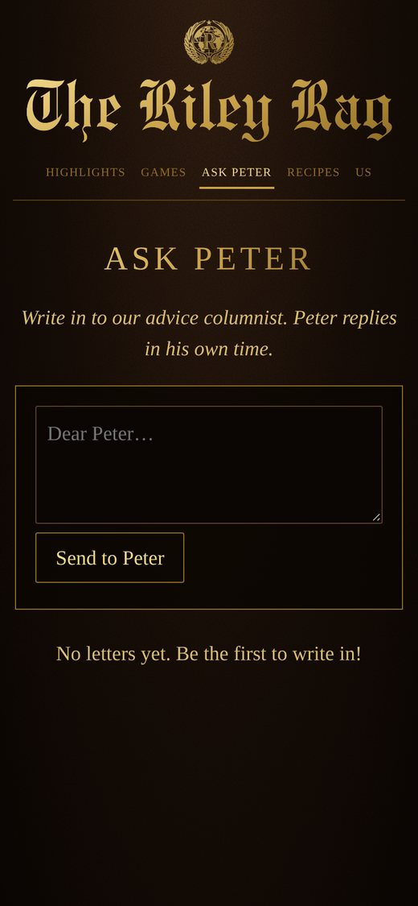
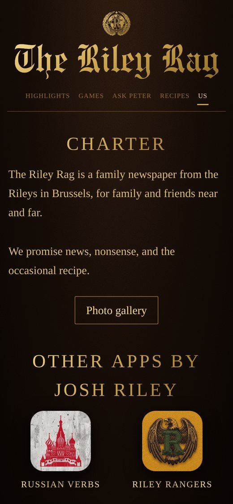

<h1 align="center">The Riley Rag</h1>

<em>The family newspaper, delivered to everyone's phone.</em>

<a href="https://joshp523.github.io/RileyRag/"><b>▶ Open the app</b></a>

The Riley Rag is a private newspaper for the Riley family and friends. Every edition lands in one place, and everyone can react, comment, play, and write in, from Brussels to wherever Grandma is reading.

## What's inside

- **Highlights:** every issue, newest first. Tap to read, leave a comment, or react with one of five hand-drawn stickers (*Love it*, *Silly!*, *Tell me more*, *So sleepy*, *I object*).
- **Games:** *Riled Up*, a daily guess-the-word game with a family leaderboard, plus links to QuipRash and Word Games.
- **Ask Peter:** write to the family's advice columnist. He replies in his own time.
- **Recipes:** the family recipe cards, kept in one tidy box.
- **Us:** the family charter, the shared photo gallery, and the other apps in the Riley collection.

<table><tr><td align="center" valign="top"> Games and the leaderboard</td><td align="center" valign="top"> Ask Peter</td><td align="center" valign="top"> Us: charter, gallery and apps</td></tr></table>
## Why it's worth a look

- **Cool:** It's a real broadsheet, with blackletter masthead, gilt lettering and leather, that lives in your pocket.
- **Innovative:** Most family news gets lost in group chats. The Rag turns it into an *edition*: something to look forward to, save, and talk back to.
- **Impressive:** Members, comments, reactions, a daily word game, an advice column, recipes and an email-the-family button, all in one private app that Josh built and runs himself for free.
- **Useful:** One link for the whole family. Nobody needs to install anything, and Grandma can join in as easily as the grandkids.

---

### On your phone
Open the link in Safari (iPhone/iPad) or Chrome (Android), then choose **Share → Add to Home Screen**. It gets its own icon and opens full-screen, just like an app from the store.

### More apps by Josh Riley
[QuipRash](https://joshp523.github.io/Quip-game-app/) · [Word Games](https://joshp523.github.io/Word-Games/) · [Russian Verbs](https://joshp523.github.io/russian/) · [Riley Rangers](https://joshp523.github.io/Rangers-app/) · [Habits: Josh](https://joshp523.github.io/daily-discipline/) · [Habits: Meishe](https://joshp523.github.io/Habit-tracker-app-Meishe/) · [Habits: Grandma](https://joshp523.github.io/wendys-app/) · [Writing](https://joshp523.github.io/writing-app/)

Built by Josh Riley. Setup notes for whoever maintains it are in [SETUP.md](SETUP.md).
