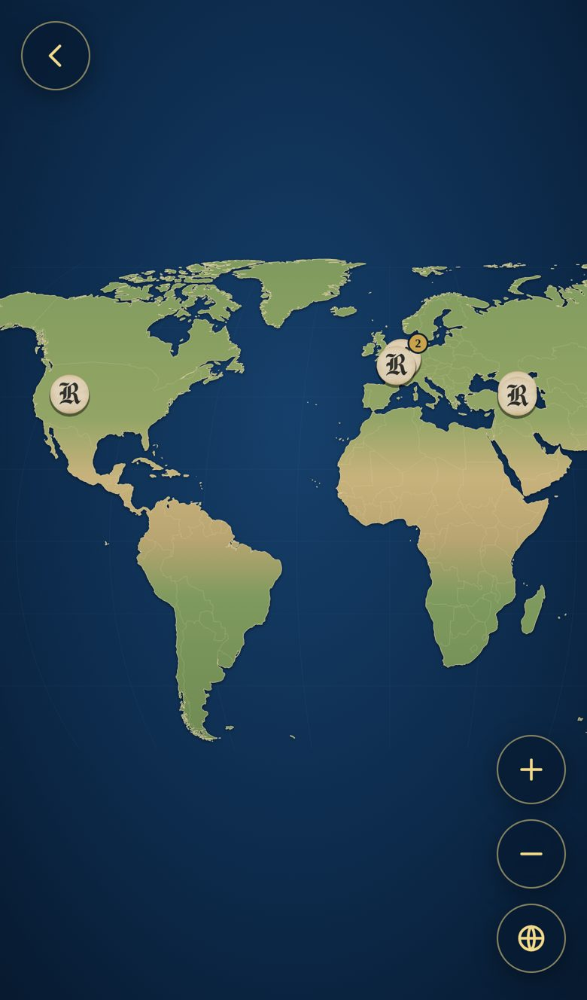
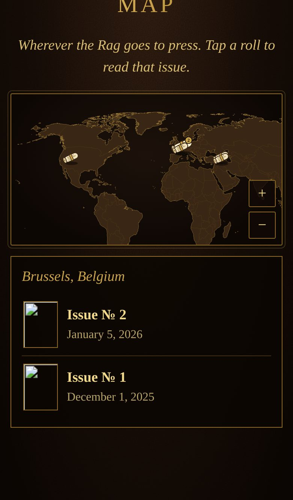
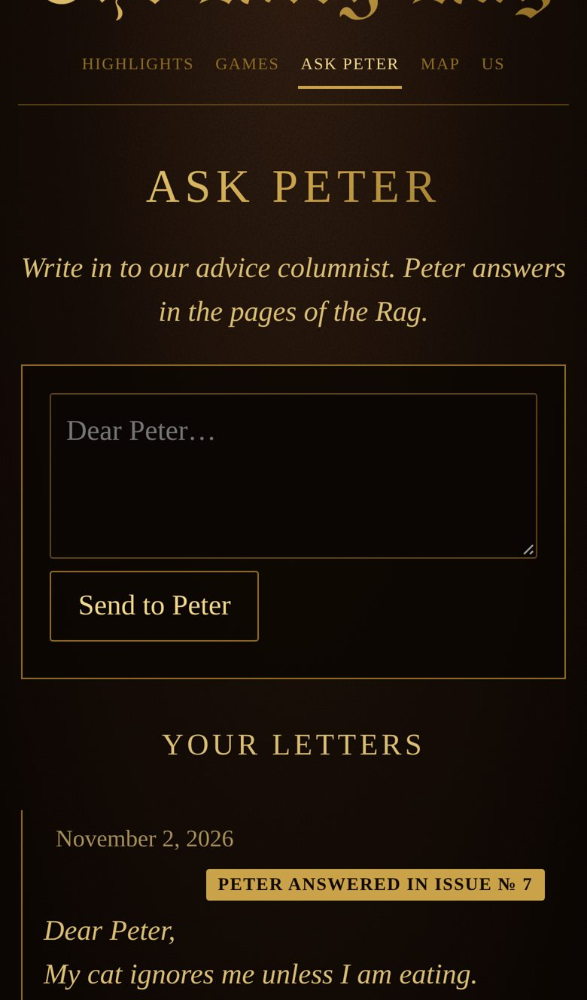
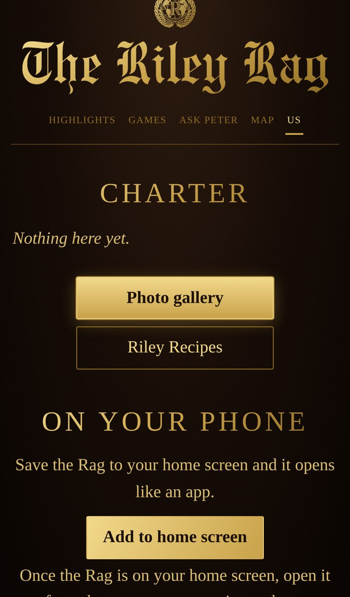

<h1 align="center">The Riley Rag</h1>
<h3 align="center">The family newspaper. Now it goes everywhere.</h3>

<a href="https://joshp523.github.io/RileyRag/"><b>▶ Open the Rag</b></a>

<table><tr>
<td align="center"> <b>The Map</b></td>
<td align="center"> <b>Tap a roll, read the issue</b></td>
<td align="center"> <b>Ask Peter</b></td>
<td align="center"> <b>Us</b></td>
</tr></table>

## ✦ Introducing the Map
**Every issue, on a map of the world.** Hand-tuned brown and gold, true coastlines, not a word of text. Just a little rolled-up newspaper wherever the Rag went to press.

**Tap a roll, read the issue.** Pinch to zoom, drag to explore. Several issues from one city share a roll, with a gold count.

**It fills itself in.** Publish from Rag Press and the issue lands on the map automatically, placed from the address on the masthead.

## ✦ Ask Peter, reimagined
**Peter answers in print.** Write in, and your letter waits for him privately.

**Your letters, your business.** Readers see only their own letters. Edit one until Peter gets to it, and see the moment he does: *“Peter answered in issue № 7.”* Your phone tells you, too.

**An editor's mailbag.** Editors see every letter, mark it answered with the issue number, or bin it.

## ✦ Everything else you love
- **Every issue,** a tap away, with reactions and comments.
- **Riled Up,** the daily word game. Who set today's word is no secret, but the word is.
- **The photo gallery,** now in gold. **Riley Recipes,** right beneath it.
- **Alerts** for new issues, straight to your phone.
- **Rag Press,** the editors' own print shop, built in.

---

### On your phone
Open the link in Safari (iPhone/iPad) or Chrome (Android), then choose **Share → Add to Home Screen**. It gets its own icon and opens full-screen, just like an app from the store.

### More apps by Josh Riley
[QuipRash](https://joshp523.github.io/Quip-game-app/) · [Word Games](https://joshp523.github.io/Word-Games/) · [Russian Verbs](https://joshp523.github.io/russian/) · [Riley Rangers](https://joshp523.github.io/Rangers-app/) · [Habits: Josh](https://joshp523.github.io/daily-discipline/) · [Habits: Meishe](https://joshp523.github.io/Habit-tracker-app-Meishe/) · [Habits: Grandma](https://joshp523.github.io/wendys-app/) · [Writing](https://joshp523.github.io/writing-app/)

Built by Josh Riley. Setup notes for whoever maintains it are in [SETUP.md](SETUP.md).
