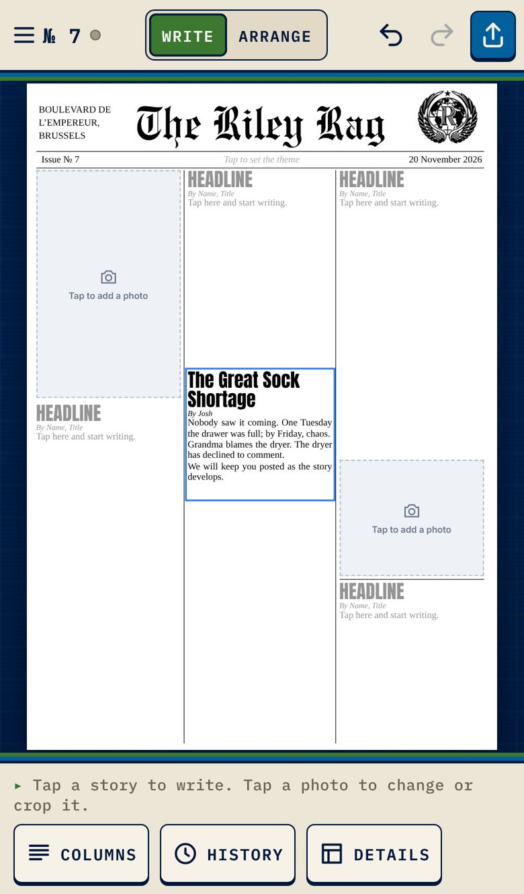
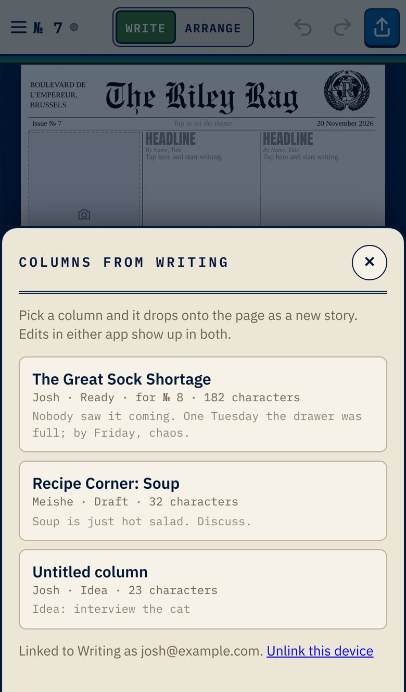
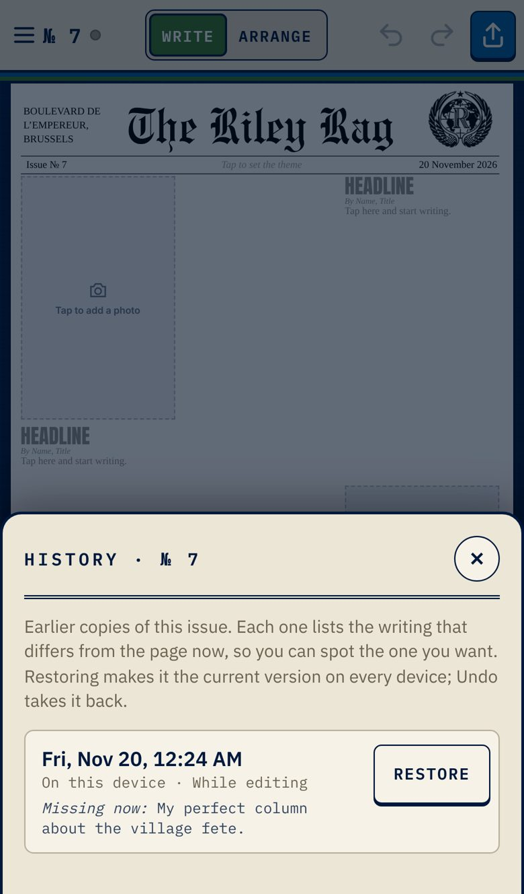

<h1 align="center">Rag Press</h1>
<h3 align="center">The Riley Rag's own print shop. In your pocket.</h3>

<a href="https://joshp523.github.io/RileyRag/press/"><b>▶ Open Rag Press</b></a>

<table><tr>
<td align="center"> <b>Lay out the page</b></td>
<td align="center"> <b>Columns from Pages</b></td>
<td align="center"> <b>History</b></td>
</tr></table>

## ✦ New: linked stories
**From draft to page in one tap.** Tap **Columns**, pick a story you wrote in the Pages app, and it lands on the page with its headline and byline.

**Live, both ways.** Edit the column in Pages, or right here on the page. Both stay in step.

**It knows the fit.** Rag Press tells Pages how much each box holds, so writers see exactly when to stop.

## ✦ Never lose a word
**History.** Every issue keeps earlier copies, on your phone and online. See what's missing at a glance, and restore with one tap.

**Smarter sync.** Two phones, one issue, no surprises: an out-of-date copy can't overwrite newer work.

## ✦ Made for the Rag
- **The real masthead and emblem,** locked in place, so every issue looks like the Rag.
- **Story and photo boxes** on a newspaper grid. Drag, resize, layer text over pictures.
- **Type, tuned by hand.** Times and Anton, with sliders for size, letter spacing and line spacing.
- **Crop and rotate** photos right on the page.
- **Publish straight to the Rag,** and the issue appears on the Rag's world map automatically.
- **Export** a print-ready PDF or PNG.

---

Built by Josh Riley.
